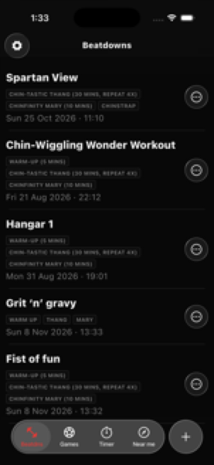
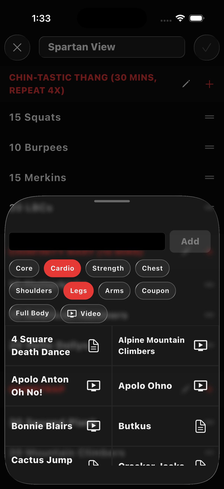
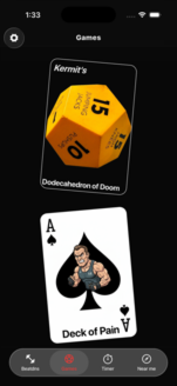
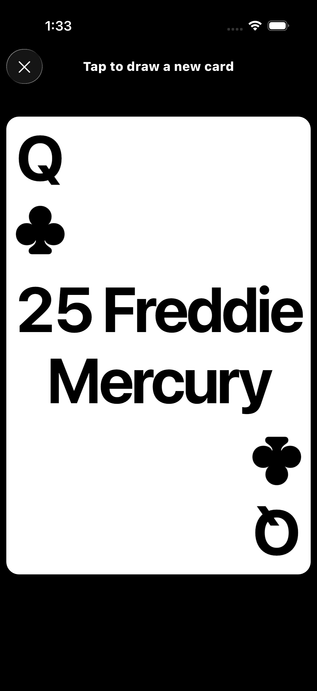
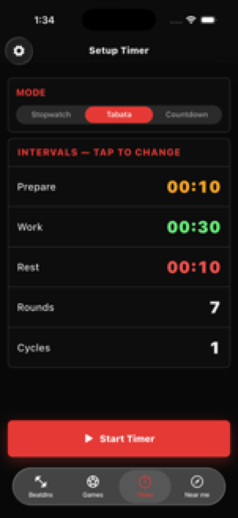
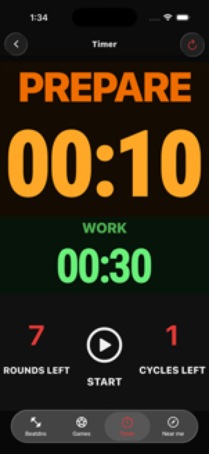
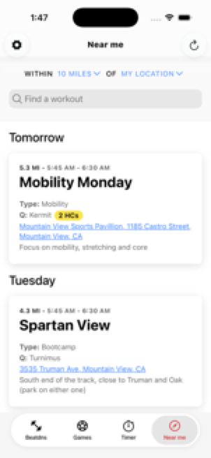
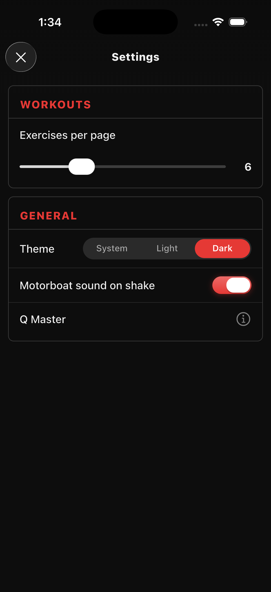
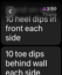

# Q Master

Q Master is an unofficial F3 workout companion and digital weinke. Create and
lead beatdowns, use workout games and timers, find nearby workouts, and view
synced beatdowns on a paired watch.

## App features

The phone app has four tabs. The settings button is available from each tab.

### Beatdowns

<table>
<tr valign="top">
  <td width="50%"></td>
  <td width="50%"></td>
</tr>
</table>

- **Create and edit:** Add a beatdown manually, give it a name, and organize
  exercises into named sections. Add, rename, delete, and reorder sections and
  exercises, including moving exercises between sections. Paste exercise text
  from the clipboard.
- **Exercise picker:** Search the F3 Codex Exicon by name or alias, filter by
  category or video availability, read descriptions, and open available
  exercise videos. The last successful Exicon response is cached for offline
  use; a first fetch requires a network connection.
- **Generate:** Enter a prompt or dictate it with speech recognition to request
  an AI-generated workout. Review and edit the result like any other beatdown.
  Generation requires a network connection.
- **Lead a beatdown:** Open a saved workout and start its paged, large-text
  exercise browser. Swipe through the pages; pinch to change the number of
  exercises displayed per page.
- **Manage and share:** Reorder, duplicate, or delete saved workouts. Share a
  formatted text version or a `.qmw` file; open a received `.qmw` file in
  Q Master to import it.
- **Post to Slackblast:** Select a region, AO, and event date and confirm the
  update. The app writes the workout's rich-text backblast to the F3 Nation
  event and can then open Slack; it does not post directly to Slack. This
  requires network access.

### Games

<table>
<tr valign="top">
  <td width="50%"></td>
  <td width="50%"></td>
</tr>
</table>

- **Dodecahedron of Doom:** Shake the device to roll the animated
  dodecahedron and select an exercise.
- **Deck of Pain:** Tap to reveal cards from a shuffled deck, then tap to
  advance to the next exercise.

### Timer

<table>
<tr valign="top">
  <td width="50%"></td>
  <td width="50%"></td>
</tr>
</table>

Choose **Stopwatch**, **Tabata**, or **Countdown**. Configure the preparation
interval and, depending on the mode, work and rest intervals, rounds, and
cycles. Start the timer to see the active display, pause or reset it, and hear
phase sounds and countdown cues. The app keeps the screen awake while the
timer is running.

### Near me

<table>
<tr valign="top">
  <td width="50%"></td>
  <td />
</tr>
</table>

Browse [F3 Near Me](https://f3near.me) in the app's web view to find workouts.
The view can use location services, has a refresh action, and opens external
links outside the web view. The map requires a network connection.

### Settings and watches

<table>
<tr valign="top">
  <td width="50%"></td>
  <td width="50%"></td>
</tr>
</table>

Settings include exercises per beatdown page, system/light/dark appearance,
the shake-triggered sound, and app information. Timer settings, exercise
filters, and the last selected Slackblast region and AO are also remembered.

Saved phone workouts are sent to a paired Apple Watch or Wear OS watch when
the list is saved. The watch apps display the synced workout list, sections,
and exercises. Wear OS also stores received workouts locally. Sync depends on
the platform's watch connectivity and pairing.

## Architecture and data flow

The app is organized by feature, with shared models, services, and adaptive UI
components:

- **Navigation and views:** [`main.dart`](lib/main.dart) initializes
  preferences, Firebase, audio, and the Riverpod scope.
  [`app_router.dart`](lib/app_router.dart) defines independent navigation
  stacks for the four tabs, hosted by [`AppShell`](lib/ui/app_shell.dart).
  Feature tabs and screens render the UI; shared platform-adaptive controls
  live in [`lib/ui/`](lib/ui/).
- **Models and state:** [`Workout` and `WorkoutSection`](lib/model/workout.dart)
  represent a beatdown. [`WorkoutListController`](lib/model/workout_list_controller.dart)
  is a Riverpod notifier that manages the list, disk persistence, and watch
  sync. [`WorkoutTimerController`](lib/timer/workout_timer_controller.dart) is a
  Riverpod notifier for timer state and sounds.
  [`SharedAppPrefs`](lib/utils/shared_app_prefs.dart) exposes
  locally persisted settings through notifiers. Freezed models and Riverpod
  providers use generated Dart files.
- **Local workout data:** The workout controller loads and saves
  `workouts.json` in the app documents directory, keeps a backup, migrates
  older formats on read, and syncs saved state to the watch. Workout sharing
  uses [`WorkoutFormatting`](lib/model/formatted_workout.dart) and the
  platform share sheet.
- **Exicon:** [`ExiconFetcher`](lib/services/exicon_fetcher.dart) requests
  the F3 Codex API and caches its latest response in the app cache directory.
  It converts responses into [`ExiconEntry` and `ExiconTag`](lib/model/exicon.dart);
  [`exicon_catalog.dart`](lib/workouts/exicon_catalog.dart) prepares searchable
  exercises and filters for the workout UI.
- **AI:** [`GeminiClient`](lib/ai_clients/gemini_client.dart) sends workout
  prompts to Gemini through Firebase AI and returns JSON for the workout
  generator to parse into a `Workout`.
- **F3 Nation:** [`F3NationClient`](lib/services/f3_nation_client.dart) uses
  Firebase callable functions for region, AO, and event requests and
  backblast updates. The corresponding data objects are in
  [`f3_nation.dart`](lib/model/f3_nation.dart). The functions in
  [`functions/src/index.ts`](functions/src/index.ts) call the F3 Nation API
  using a server-side Firebase secret; the API key is not stored in the app.
- **Watch apps:** The phone controller sends workout data through
  `watch_connectivity`. The Apple Watch SwiftUI app receives it using
  WatchConnectivity; the Wear OS app receives messages or data-layer updates
  through `WatchDataService` and exposes them through `WorkoutRepository`.

Network-dependent features are the Exicon refresh, AI generation, F3 Nation
requests, Near Me, and hosted exercise videos. Saved workouts and a previously
cached Exicon can be used without a network connection.

## Source organization

| Location | Responsibility |
|---|---|
| [`lib/main.dart`](lib/main.dart), [`lib/app_router.dart`](lib/app_router.dart) | Initialization, app configuration, and tab routes |
| [`lib/workouts/`](lib/workouts/) | Beatdown list, editor, exercise picker, generation, sharing, and leading a workout |
| [`lib/games/`](lib/games/) | Game selection, game views, dodecahedron rendering, and face definitions |
| [`lib/timer/`](lib/timer/) | Timer controller, setup tab, and active timer screen |
| [`lib/near_me/`](lib/near_me/) | Near Me web view |
| [`lib/settings/`](lib/settings/) | Shared settings sheet |
| [`lib/slack/`](lib/slack/) | Region/AO/event picker for the Slackblast workflow |
| [`lib/model/`](lib/model/) | Workout, game, Exicon, and F3 Nation objects; workout state |
| [`lib/services/`](lib/services/) | Exicon fetching and F3 Nation network client |
| [`lib/ai_clients/`](lib/ai_clients/) | Firebase AI workout generation client |
| [`lib/ui/`](lib/ui/) | Shared adaptive navigation, menus, sheets, controls, and app shell |
| [`lib/utils/`](lib/utils/) | Preferences, audio session coordination, formatting, and other shared helpers |
| [`lib/l10n/`](lib/l10n/) | Localization source and generated localization code |
| [`lib/theme/`](lib/theme/), [`assets/`](assets/), [`shaders/`](shaders/) | Themes, fonts, images, sounds, and game shader |
| [`ios/Q Master Watch App/`](ios/Q%20Master%20Watch%20App/) | SwiftUI Apple Watch app and WatchConnectivity receiver |
| [`android/watchapp/`](android/watchapp/) | Wear OS app, data-layer receiver, and workout repository |
| [`functions/`](functions/) | Firebase callable functions for the F3 Nation API |
| [`test/`](test/) | Flutter model, workout UI, and client tests |
| [`docs/`](docs/) | Hosted download pages and related website assets |

For example, the Beatdowns feature connects `WorkoutsTab` and its editor to
`WorkoutListController` and `Workout`; the exercise picker additionally uses
`ExiconFetcher`, `ExiconEntry`, and the workout catalog. `AdaptiveMenuItem`
remains with `AdaptiveMenu` in [`adaptive_menu.dart`](lib/ui/adaptive_menu.dart)
and is also reused by adaptive accessory actions.

### Further organization considerations

- [`ContentView.swift`](ios/Q%20Master%20Watch%20App/ContentView.swift)
  contains watch models, the connectivity view model, and views. If the
  watch app grows, separating those responsibilities into model, connectivity,
  and view files could make them easier to find.
- `WorkoutListController` still combines persistence and watch sync with
  state management. Separate storage and watch-sync services could help if
  those responsibilities grow; the current behavior remains together.

## Development

Install the Flutter SDK compatible with [`pubspec.yaml`](pubspec.yaml), then:

```sh
flutter pub get
dart run build_runner build --delete-conflicting-outputs
flutter analyze
flutter test
```

Generated Freezed, Riverpod, JSON, and localization files are not tracked;
regenerate them after changing their source definitions. The Gemini test in
[`gemini_client_test.dart`](test/ai_clients/gemini_client_test.dart) is marked
`live_network` and requires an initialized Firebase app and network access;
use `flutter test --exclude-tags live_network` for the remaining tests.
Run the app on the relevant target device or simulator to verify platform and
watch behavior.

## Why Flutter?
Dart/Flutter was chosen over native Swift or Kotlin development, so that we can keep changes in lockstep and get them out to iOS and Android users with minimal additional effort. It is by far the, fastest most productive cross-platform development framework I have ever used and perfect for a small team.
Downside: Dart is not a well-known language, but it is very similar to modern languages like Typescript, Swift and Kotlin and it's super-easy to learn.

## A note on platform widgets
Flutter uses "Material Design" by default which is the standard design language for Android. All [widgets](https://docs.flutter.dev/ui/widgets/material) in the flutter/material library support this design system.

Flutter also has a set of "Cupertino" [widgets](https://docs.flutter.dev/ui/widgets/cupertino) in the flutter/cupertino library which mimic Apple's iOS look and feel.

Since I'm a UX purist, I prefer to have the UI look native to the platform where it is used and have iOS users feel at home (i.e. use both Material and Cupertino where it makes sense), so this codebase makes liberal use of:

* In the Flutter framework:

** Adaptive widgets in the Flutter framework: Switch.adaptive, Slider.adaptive, etc. which wrap the Flutter Material and Cupertino widgets. More examples [here](https://docs.flutter.dev/ui/adaptive-responsive/platform-adaptations#widgets-with-adaptive-constructors)

 * Adaptive icons, i.e. Icons.adaptive.more, Icons.adaptive.settings, etc.

* Additional frameworks:

 * The [liquid_glass_widgets](https://pub.dev/packages/liquid_glass_widgets) package provides a good emulation of Apple's liquid glass, with morphing effects and blurs.

Some helper classes have been added to handle the heavy lifting for UI masonry and common controls. See the following in the ui/ directory:

 * AdaptiveAppBar
 * AdaptiveScaffold
 * AdaptiveTabBar
 * AdaptiveModalSheet
 * AdaptiveSlider
 * AdaptiveSwitch
 * AdaptiveIcons (for those not covered by Flutter Icons.adaptive and PlatformIcon).
 * AdaptiveMenu
 * showAdaptiveDraggableSheet
 * showAdaptiveModalSheet (adapts the content into a dialog for tablets)

* (Legacy) The [flutter_platform_widgets](https://pub.dev/packages/flutter_platform_widgets) package, which wraps equivalent higher-level widgets for both platforms and gives you a simple API to target both. Prefer the Adaptive* variant above where one exists or where you desire a glass layer on iOS. Use these for everything else.

  * Use PlatformText rather than Text
  * Use PlatformIconButton rather than IconButton
  * Use PlatformTextButton rather than TextButton
  * Use PlatformListTile rather than ListTile

## Workout JSON Format

Workouts are persisted to `workouts.json` in the app's documents directory and synced to the paired watch via WatchConnectivity / Wearable Data Layer. The file is a JSON array of workout objects.

### Schema

| Field | Type | Description |
|-------|------|-------------|
| `name` | `string` | Display name of the workout |
| `date` | `string` | ISO-8601 timestamp, e.g. `2026-03-29T05:30:00.000` |
| `sections` | `array` | Ordered list of section objects; each section has a `name` string and an `exercises` string array |

Section names are arbitrary strings. By convention the three standard F3 sections are used (`warmup`, `thang`, `mary`), but any names are valid. Order is preserved through all serialization round-trips.

### Example

```json
[
  {
    "name": "The Bear Crawl Beatdown",
    "date": "2026-03-29T05:30:00.000",
    "sections": [
      {
        "name": "warmup",
        "exercises": ["SSH", "Imperial Walkers", "Arm Circles"]
      },
      {
        "name": "thang",
        "exercises": ["Bear Crawl", "Merkins", "Lunges"]
      },
      {
        "name": "mary",
        "exercises": ["LBCs", "Flutter Kicks"]
      }
    ]
  }
]
```

### Backward Compatibility

The app can read files written by older versions of the app. Legacy layouts are migrated on read and re-written in the current format on next save:

- **v1 (legacy)** — `warmup`, `thang`, and `mary` as top-level keys on the workout object, with section values as either `{ "name": "..." }` objects or plain strings.
- **v2 (current)** — `sections` as an ordered array of section objects (`{ "name": "...", "exercises": ["..."] }`), preserving section order across all platforms.

## Git Hooks

The project ships a pre-commit hook that automatically increments the build number in `pubspec.yaml` on every commit (e.g. `3.0.1+460` → `3.0.1+461`).

After cloning, run once to activate it:

```sh
sh tool/setup_hooks.sh
```

This sets `core.hooksPath` to `.githooks/` so git picks up the hook from version control.

## Building the app for the Play Store
(In the top-level q_master directory)

Build Android app:
  `flutter build appbundle`
  The output AAB will be under build/app/outputs/bundle/release/app-release.aab

Build Wear app:
  `./android/gradlew -p android :watchapp:bundleRelease`
  The output AAB will be under build/watchapp/outputs/bundle/release/watchapp-release.aab

## Cloud Functions
Cloud functions are used to call F3 Nation RPCs from https://api.f3nation.com/docs that require a secure API key.
To deploy cloud functions:

```sh
npm --prefix functions run build
firebase deploy --only functions
```

## Android Minification Gotcha

If release builds are minified (`isMinifyEnabled = true`), R8 can strip Flutter utility classes used by `path_provider`, which can break workout save/load at runtime.

Symptom seen in logcat:
`ClassNotFoundException: io.flutter.util.PathUtils`

Fix: keep these classes in `android/app/proguard-rules.pro`:

```pro
-keep class io.flutter.util.PathUtils { *; }
-keep class io.flutter.embedding.engine.loader.FlutterLoader { *; }
```

After updating rules, rebuild and reinstall the release artifacts.

## Marketing URL
https://q-master-7346a.web.app/download.html<br>
https://q-master-7346a.web.app/download-summer.html

Deploy website:
  `firebase deploy --only hosting --project q-master-7346a`
